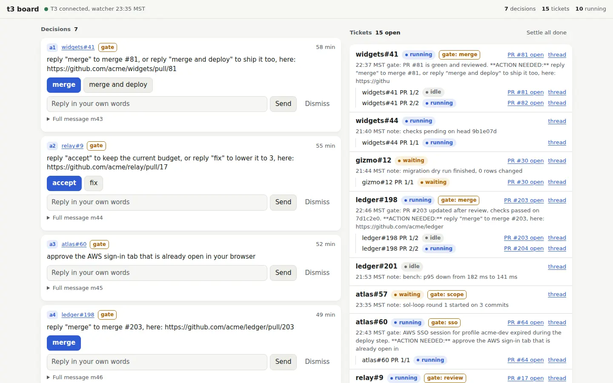

# Board UX research

Design research for [issue #28](https://github.com/OttoOps/t3-codemode/issues/28),
which turns the board from one long scrolling page into a fixed panel
layout. This folder holds the first three steps of that issue. PR 2 builds
the redesign against them and commits its blind-judging scores in
`judging/`.

[Issue #67](https://github.com/OttoOps/t3-codemode/issues/67) adds a
readability pass on top: a critique of the shipped board under the live
load, a Glanceability axis in the rubric, and mockups of the proposed
direction.

| Path | What it holds |
| --- | --- |
| [`review.md`](review.md) | The paired design review of the current board: verdict, findings by area with evidence, what must survive, the functionality inventory, and how the two reviewers settled their disagreements. |
| [`review/`](review/) | The four source documents: each reviewer's independent review and each one's reading of the other's. |
| [`layouts.md`](layouts.md) | The proposed layouts (A recommended, B fallback), the behavior contract for live updates, replies, connection and keyboard, and the visual direction with type, spacing and color tokens. |
| [`rubric.md`](rubric.md) | The scorable rubric, the blind-judging protocol and the rule a candidate must meet to ship, with the current board's baseline for each measured criterion. |
| [`references/`](references/README.md) | Sixteen screenshots of comparable products, with source URLs, the basis for keeping each, and notes on what each does well. |
| [`current/`](current/) | Captures of the current board (commit `7e29c9d`) under realistic load, plus `report.json` with the measurements the review cites. |
| [`harness/`](harness/README.md) | The seeded demo board and the capture scripts, so every capture and measurement here can be rerun. |
| [`judging/`](judging/README.md) | The blind-judging rounds for the redesign (1 to 7) and for issue #67's readability pass (8 to 10): each round's gates, judged scores with evidence, and letter key. |
| [`critique.md`](critique.md) | Issue #67: the readability critique under the live load, the task-test baseline, and the proposed direction for the decision card, ticket row and Activity row. |
| [`live/`](live/README.md) | Issue #67: an anonymized snapshot of the live board, a read-only replay server, the capture and glance scripts, and the before- and after-stills at 1920, 1366 and 390. |
| [`mockups/`](mockups/README.md) | Issue #67: a static mockup of the direction under the same load, a component sheet, and the after-stills. |
| [`new-issues/`](new-issues/README.md) | Issue #57: before and after stills of the New issues section above Tickets, with the script that adds the issues to the live snapshot. |

## Method

1. **Fixture.** `harness/board_demo.rs` serves the board against the
   in-process fake T3, seeded with made-up `acme/*` tickets, workers, PRs,
   decisions, asks and settled work, and keeps it live with new notes, cards
   and tickets every few seconds. `harness/capture.js` took the screenshots
   and measured where Launch sits and how far a focused input moves while
   updates arrive.
2. **Paired review.** A Claude Opus agent and GPT 6.1 Sol reviewed the live
   board, the captures and `src/board.html` independently, then each read
   the other's review and took a position on nine open questions.
3. **References.** Three research agents collected screenshots of issue
   boards and queues (Linear, GitHub Projects, Jira), feeds with a pinned
   composer (Slack, Zulip, Thunderbird, Claude Code's agent view), and ops
   and CI dashboards (Grafana, Datadog, Buildkite, GitHub Actions). The agents
   used only public, signed-out pages and images the vendors published.
4. **Rubric.** The review's findings and the references' shared patterns
   became the criteria in `rubric.md`. The current board's measured values
   are its baseline.

## The current board in numbers

From `current/report.json` and the reviewers' probes, at 1440x900 with the
seeded load:

- The page is 2,345 px tall, 5,323 px with Activity and Settled open.
- The Launch textarea starts 2.22 screens down (6.55 on a 390 px phone).
- A focused Launch textarea moved 214 px in 36 s of live updates.
- A focused ticket link was detached within 9 s and focus fell to `<body>`.
- About four decision cards fit on screen; each is 156 to 221 px tall.

