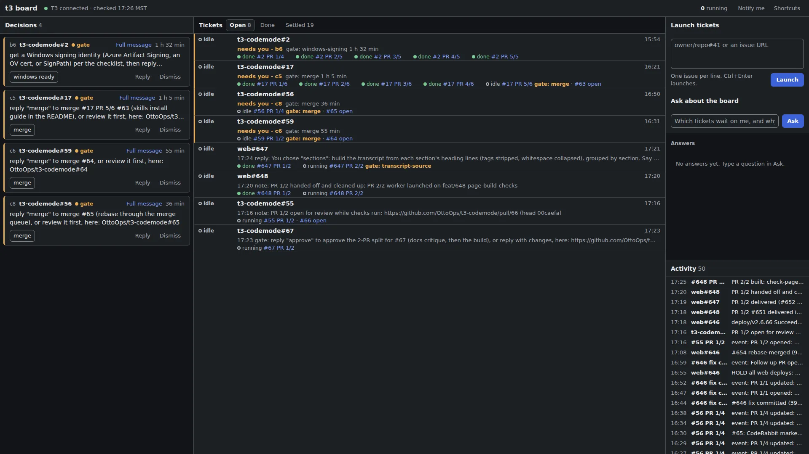
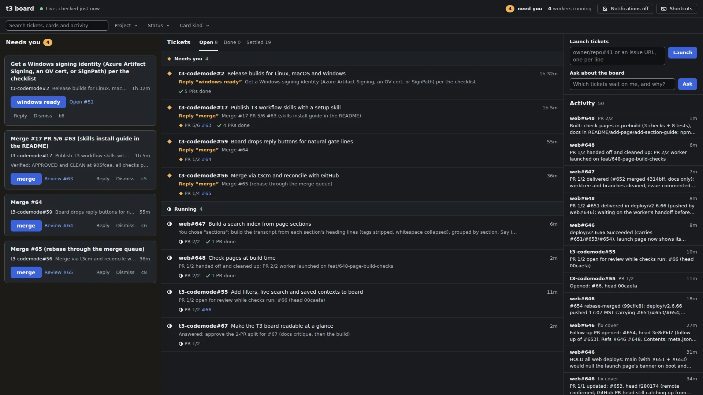
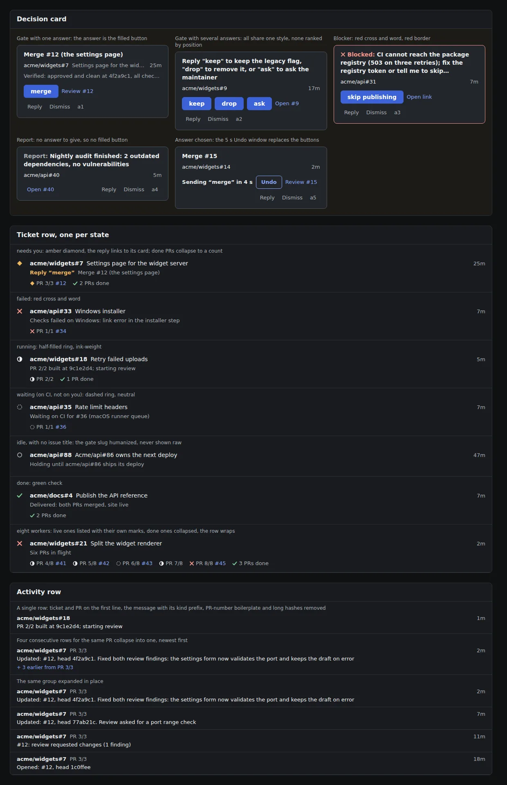

# Board readability under real load

The critique for [issue #67](https://github.com/OttoOps/t3-codemode/issues/67),
the direction it proposes, and the evidence behind both. PR 2 builds the
direction in `src/board.html` and `src/board.rs` once it is approved here.

**Verdict.** #28 fixed the board's structure, and the board is still hard
to read under real load. The fixed shell, the decisions queue and the
needs-you sort all work, but every panel has the same surface and nearly
every line is 13 or 14 px, so nothing on the page draws the eye first.
The ticket list also misreports what is running, and amber marks items that no longer
wait on anyone. All three cold readers found the four real asks in the
Decisions column, and then the Tickets panel led one to count a fifth and
left the other two unable to rule it out.
The board scores 19/40 on Nielsen's heuristics.

## Method

- **Real load.** The live board at 17:26 MST on 18 Nov 2026 had 4 decision
  cards, 8 open tickets with 18 workers, and 50 Activity rows.
  [`live/`](live/README.md) anonymizes that snapshot and replays it
  read-only, because this repository is public and the live board names a
  private one.
  All stills are at 1920x1080, 1366x768 and 390x844, in [`live/before/`](live/before/).
- **Critique.** The `impeccable` critique ran as two isolated agents. A
  Claude Opus design review read the code and the stills. A detector pass
  ran `impeccable detect`, injected its overlay into the replay, and
  measured contrast, clipping, color use and panel space. Neither saw the
  other's output.
- **Task test.** Three cold readers (Claude Haiku, Sonnet and Opus) each
  got one look at the 1920 dark still and nothing else. They had to name
  every ticket that waits on the user and the reply each one wants. The
  same test ran on the mockup. It is rubric criterion G1.

## The issue's list, checked

| Reported | Holds? | Evidence and cause |
| --- | --- | --- |
| No hierarchy between panels | Yes | Four type sizes (12 to 16 px) with 13 px on 134 of 193 text nodes. Every pane is `--panel` with a 1 px `--line` border, and `--line` is 1.89:1 against the panel in dark. The detector flags a flat type hierarchy (largest step 1.14:1). |
| Primary reply looks like Reply and Dismiss | Yes | Options render as plain `.btn`: outlined, 28 px, weight 500. The only filled buttons on the page are Launch and Ask. |
| All cards carry the same amber stripe | Yes | `.card.k-need` puts a 3 px amber rule on every gate. The detector flags it as a side-tab. It says nothing that the column heading does not. |
| PR chips clipped mid-word | Yes, at 1366 and 390 | `.wl` scrolls sideways with its scrollbar hidden. At 1366, #17's worker line holds 864 px of chips in 450 px, and the hidden part is the one chip that matters: `idle #17 PR 5/6 gate: merge · #63 open`. No ellipsis, no tooltip. At 1920 everything fits. |
| A raw gate slug as a ticket title | Yes, as row text | The live snapshot shows `gate: windows-signing` and `gate: transcript-source` printed raw. The issue's example, anonymized here as `gate: web#646_owns_the_next_deploy/...`, comes from the same `"gate: " + slug` code. Tickets have no title field until #66 adds one. |
| `running` looks like `idle` | Yes, and worse | Both map to one neutral role with the same hollow ring. The ticket row shows the orchestrator thread's own status, so all 8 tickets read `idle` while 4 workers run. The header counts running tickets, not workers, and says "0 running". |
| Orange means four things | Yes | Amber marks `needs you`, the card stripe, the card's kind dot and word, the ticket rule, the header count, and `gate:` text on workers whose gate was already answered. |
| Activity truncated, led by `event:` | Yes | The row prefixes each message with its kind. 19 of 50 rows start `event:`, 23 carry a hash of 8 or more characters, and the 88 px label column clips `t3-codem…` and `#646 fix c…`. Five `#56 PR 1/4` rows run back to back. |
| Empty Answers eats the right column | Yes | `#out` is fixed at 28vh: about 290 px of "No answers yet" at 1920. Activity shows 17 of its 50 rows in 421 px. |
| Mixed absolute and relative times | Yes | A ticket's note shows `age()` when it has a card and `clock()` when not. The right edge shows `15:54` while the card says `1 h 32 min`. |
| Header controls read as text | Yes | `.btn.quiet` has a transparent border in `--ink-2`. "Shortcuts" opens a good dialog that nothing invites you to open. |
| Done tab has no count | Yes | It prints nothing for 0, so it looks unloaded. |

## What the issue missed

- **The board answers "is anything moving?" wrongly.** The 0 in the header
  and the 8 `idle` rows sit beside four `running` workers. The design
  review said it made it doubt the rest of the board, and Sonnet read the
  screen as if nothing were waiting.
- **Answered gates still look open.** #67's note reads `17:23 gate: reply
  "approve" to approve the 2-PR split…` after it was approved, and #647's
  worker shows amber `gate: transcript-source` after Paul chose. Every
  cold reader stopped on #67; Haiku listed it as a fifth ask.
- **Cards open with the agent's instruction.** `reply "merge" to merge
  #64, or review it first, here: OttoOps/t3-codemode#64` makes you read to
  the end to learn that the ask is a merge. The 2-line clamp cuts c5's PR
  link.
- **The two lists sort differently.** Decisions puts #59 before #56; Tickets
  puts #56 first. Matching a card to its row means reading ids.
- **Borders fail 3:1.** Every text pair passes AA (the lowest is 5.38:1),
  but `--line` dividers are 1.27 to 1.38:1 in light and 1.89 to 2.13:1 in
  dark. Stale content at 0.55 opacity would drop to 2.50:1.
- **Space under content.** Decisions and Tickets each leave about 480 px
  empty below their last item at 1920, while Activity scrolls.

## What works and stays

- The fixed shell: header, panel titles and composers stay put and only
  lists scroll, with arrivals held in a count.
- Needs-you tickets sort first and link to their cards, and back.
- The 5-second Undo window on every reply, and drafts that survive
  re-renders.
- Keyboard reach: skip links, `j`/`k`, `g` chords, the shortcuts dialog.
- Status words always sit next to their marks, and text contrast is AA in
  both themes.

## Scores

| # | Heuristic | Score | Key issue |
| --- | --- | --- | --- |
| 1 | Visibility of system status | 1 | "0 running" beside 4 running workers; every ticket `idle`. |
| 2 | Match with the real world | 2 | Gate slugs, `event:` prefixes, cards that lead with the agent's instruction. |
| 3 | User control | 3 | Undo and Restore work; Dismiss is one click. |
| 4 | Consistency | 1 | Amber carries four meanings; two time formats in one row; two sort orders. |
| 5 | Error prevention | 2 | Answered gates invite a second reply. |
| 6 | Recognition over recall | 2 | Cards and rows are matched by id; the actionable chip is hidden. |
| 7 | Flexibility | 3 | Good shortcuts, hard to discover. |
| 8 | Minimalism | 1 | A wide `idle` gutter, an empty PR column, 290 px of empty Answers. |
| 9 | Error recovery | 2 | Error strips exist; not exercised by this load. |
| 10 | Help | 2 | The shortcuts dialog is good and hidden. |
| | **Total** | **19/40** | Poor |

The detector agreed on the flat hierarchy and the side stripes, and
flagged cramped padding on the panel headers and ticket rows. The padding
flags are false positives: the headers are fixed-height bars with centered
text.

## Task test

| Reader | Current board | Mockup |
| --- | --- | --- |
| Haiku | 4 asks right, plus #67 as a fifth. 17.0 s. | 4 asks right, nothing extra. 14.6 s. |
| Sonnet | 4 asks right; "could not tell" if #67 waits. 9.2 s. | 4 asks right, nothing extra. 8.3 s. |
| Opus | 4 asks right; "maybe #67". 14.3 s. | 4 asks right, nothing extra. 13.2 s. |

The times are agent wall-clock and only a rough proxy for a person.
Accuracy moved more than time did: no reader answered cleanly on the
current board, and all three did on the mockup. Paul's own
timed cold look at the current board and at PR 2's build is part of G1.

On the mockup the readers still raised three points. The same asks appear
in two panels, the card ids (`b6`, `c5`) mean nothing to a newcomer, and
an ask like "Merge #17 PR 5/6 #63" mixes ticket, PR count and PR number.
The direction answers the first two below and leaves the third as an open
question.

## Direction

Keep #28's panels, its behavior and every function, and give each panel one
thing that reads first. The mockups are in [`mockups/`](mockups/README.md).

### Panels

- **Decisions becomes "Needs you"** and is the one raised surface: a warm
  step off the canvas (`#1c1a17` dark, `#fbf7ef` light) with a stronger
  header rule. Its count is the board's only filled amber pill, repeated in
  the header and on the phone tab.
- **Panel headings move to 16/600**, with counts in `--ink-2`. Content stays
  at 14 and meta at 13 and 12. That keeps P2's four sizes and three weights,
  with the step at the panel level, where the eye needs it.
- **Tickets groups rows by state.** A `Needs you 4` header row comes first, then `Running 4`,
  then failed, waiting, idle and done as they occur. Within Needs you, rows
  follow the cards' order, so the two lists match.
- **Answers collapses when empty.** Launch and Ask stay pinned at the top of
  the right column; answers appear under Ask only when there is one.
  Activity takes the rest.
- **The header counts cards and workers.** It reads `4 need you · 4 workers
  running`. Notifications and Shortcuts become outlined
  buttons with icons.
- **The Tickets tabs** read `Open 8  Done 0  Settled 19` with an underline on
  the selected one, and every tab shows its count.

### Decision card

1. **The ask comes first**, at 14/600, up to three lines. The board strips
   the action line's scaffolding: `reply "merge" to merge #64, or review it
   first, here: <url>` becomes "Merge #64". With several options, the
   sentence keeps its `reply "keep" … "drop" …` form, since the words are
   the choices.
2. **Context on one line.** The ticket label, the issue title from #66's
   `title` field, and the age, all in meta. Verification detail ("Verified: APPROVED and
   CLEAN at 905fcaa…") takes one clamped line under it.
3. **The answer is the most prominent control.** It is a filled 32 px button with
   the option's own words. Several options share that one style, so none
   is ranked by position, which keeps U8's rule against index-based
   styling.
4. **Then the PR or issue link** ("Review #63", "Open #51"), and on the
   right, quiet Reply, Dismiss and the card id, which opens the full
   message. The id stays for keyboard and `t3wf` users; it no longer
   competes.
5. **No stripe.** A blocker gets a red cross, the word "Blocked:" and a red
   border. A report gets "Report:" in grey and no filled button, since it
   asks for nothing. The Undo window replaces the buttons with
   `Sending "merge" in 4 s [Undo]`.

### Ticket row

1. **A 24 px mark column** replaces the 84 px status gutter. The shape
   carries the state; the group header carries the word.
2. **Line 1.** The label in 600, then the issue title. With no title, the gate
   or label humanized ("Acme/api#86 owns the next deploy"), so no raw slug
   reaches the screen.
3. **Line 2.** For a ticket that needs you, the amber link `Reply "merge"`,
   which focuses the card, and then the ask. Otherwise the last message with its
   kind prefix removed. An answered gate reads "Answered: approve the 2-PR
   split…" in neutral.
4. **Line 3, workers.** Live workers each with their own mark, PR link and
   no `gate:` text; done workers collapse to "✓ 4 PRs done", which expands.
   The line wraps, so nothing is cut.
5. **Age on the right**, relative, absolute in the tooltip. A row's state is
   the most urgent of its own and its workers'.

### States and color

| State | Shape | Word | Color |
| --- | --- | --- | --- |
| needs you | filled diamond | needs you | amber, only here |
| failed, blocker | cross | failed | red |
| running | half-filled ring | running | full ink, 600 |
| waiting (on CI or another ticket) | dashed ring | waiting | `--ink-2` |
| idle | hollow ring | idle | `--ink-2` |
| done | check | done | green |

Blue stays on links, focus and the filled buttons. Amber appears only
where a decision card is open and on the Needs you counts. Running gets
full ink and weight 600 with no hue of its own, so it reads as alive
without competing with amber.
This reverses #28's "running recedes" rule, which the live load showed
was wrong: whether anything is moving is half of the glance.

### Activity row

1. **Line 1.** The ticket label in 600, then the worker (`PR 1/4`, `fix
   cover`) in meta, and the age on the right. Worker rows map back to
   their ticket's label with #66's `ticketLabel`, so one label scheme runs
   through the board.
2. **Line 2.** The message, clamped to two lines. The board drops the kind
   prefix, the `PR 1/4` that repeats the label, the `Publishing:` tail,
   and duplicate links, and shortens hashes to 7 characters and GitHub
   URLs to `#65`.
3. **Consecutive rows** for the same ticket or PR collapse into the newest,
   with "+ 4 earlier from PR 1/4", which expands in place.

### Time

Relative ages everywhere (`2m`, `1h 32m`), the absolute time in the
tooltip, and the zone once, in the header's tooltip.

### Phone

The same three panels as tabs at the bottom, with the composer pinned
above them. The header keeps the title, the connection dot, the Needs you
pill and two icon buttons. Cards, rows and Activity use the same
components at full width; rows wrap the title under the label.

### Building on #66

PR 2 starts after #66 merges and keeps its filter bar under the header as
the mockup shows it. Two touch points:

- #66's Status filter offers "waiting on me". PR 2 renames it "needs you",
  so the filter, the group header and the mark share one word.
- The ticket title and the Activity `ticketLabel` come from fields #66 adds
  to `/api/state`. The direction adds no service fields of its own. The
  worker count in the header and a ticket's derived state are computed in
  the page.

## Open questions for the approval

1. **Should needs-you tickets stay in both panels?** Every mockup reader
   noticed the duplication. The direction keeps both, because the row
   carries the ticket's history and workers and the card carries the
   reply. The alternative is a one-line row that only points at the card.
2. **Should the board rewrite asks further?** "Merge #17 PR 5/6 #63" is the
   worker's own wording. The board could reduce it to "Merge PR #63", or
   the worker skill could change what it writes.
3. **Is the warm Needs you surface right?** It is the only tinted panel. A
   neutral raised surface would keep amber to the pill and the marks.
