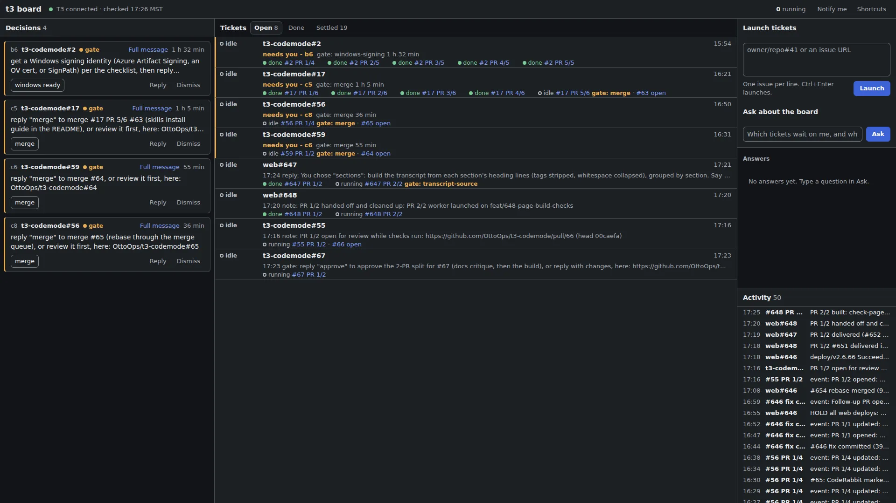
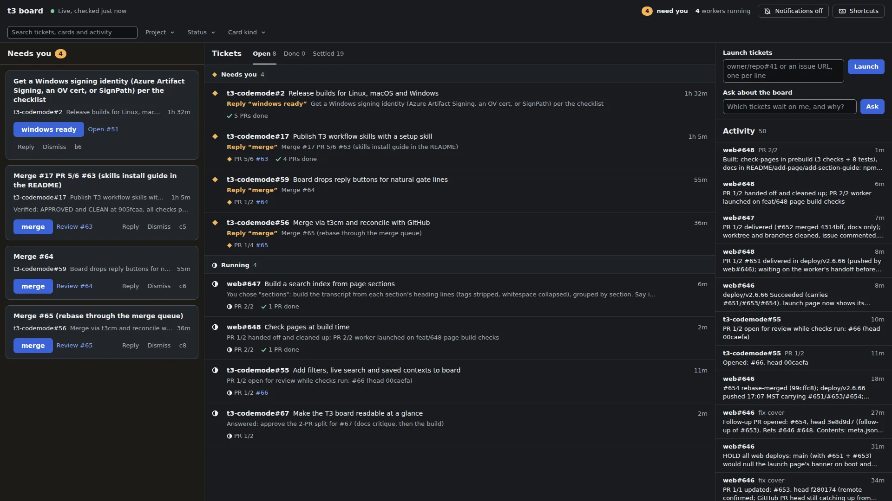
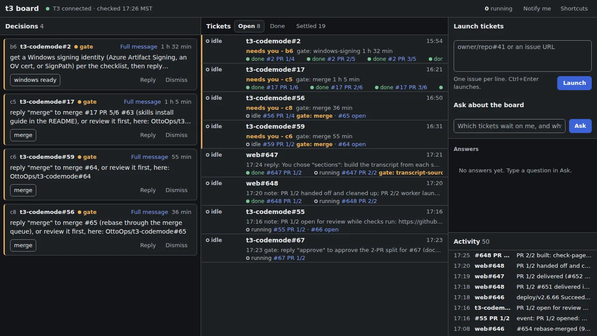
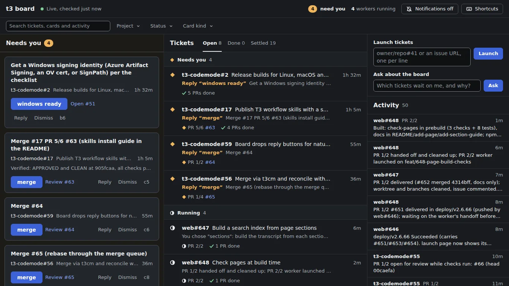
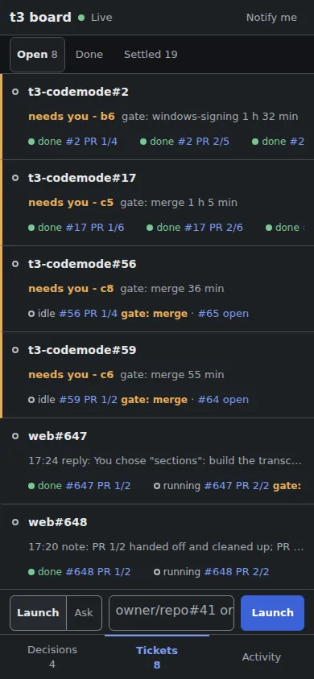
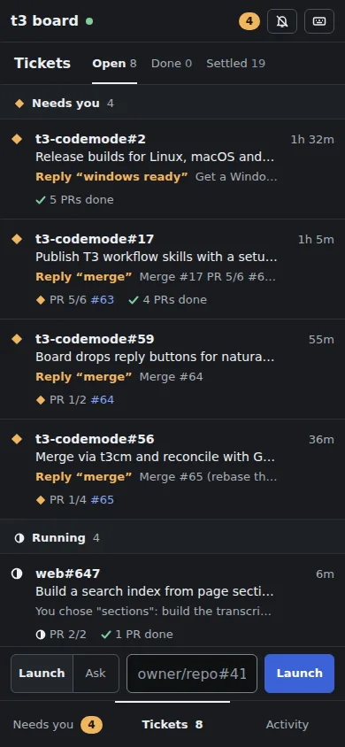

# Mockups for issue #67

Static mockups of the direction in [`../critique.md`](../critique.md). They
are design artifacts, not the build: PR 2 implements the direction in
`src/board.html`.

`board.html` is one self-contained page with the live snapshot from
[`../live/state.json`](../live/state.json) inlined. Open it in a browser.

| Query | Shows |
| --- | --- |
| (none) | The whole board under the live load, in the system theme. |
| `?theme=dark` or `?theme=light` | One theme. |
| `?panel=p-dec`, `p-tix` or `p-right` | At phone width, which panel is open. |
| `?composer=ask` | At phone width, the pinned composer switched from Launch to Ask. |
| `?view=sheet` | The component sheet: every decision card state, a ticket row in each of the six states, and an Activity row single, grouped and expanded, on made-up `acme/*` data. |

The page renders its data with small functions that show the rules the
direction proposes: how a card's ask is pulled from the action line, how a
ticket's state is derived from its workers, how Activity text is cleaned and
grouped, and how a missing title falls back to a humanized slug. Its own
times are fixed to the snapshot (17:26 MST), and it uses the issue titles
#66 will put in `/api/state`.

`after/` holds the stills taken at the same sizes as
[`../live/before/`](../live/before/): 1920x1080 dark and light, 1366x768
dark, and 390x844 dark for each panel, plus the component sheet in both
themes. `report.json` has the same measurements as the before report, from
`../live/capture.js`, including each phone panel.

| | Before | After |
| --- | --- | --- |
| 1920 |  |  |
| 1366 |  |  |
| 390, tickets |  |  |
