# Reference UIs

Sixteen screenshots of products that do the board's job: several panes, queues
that update live, and an input that is always within reach. The rubric in
[`../rubric.md`](../rubric.md) cites them by file name, and the blind judges in
PR 2 score candidates against them.

## How they were collected

Three research agents each took one group, on 2026-11-17. Every image is
either a live capture of a public page that needs no login and shows staged
or synthetic data, or a screenshot the vendor published on its own product
page or docs. Nothing was captured while signed in. Images that showed real
people's names or avatars were left out, which is why some views (a GitHub
Actions run list, a Buildkite build list, Discord) are missing.
In the images kept, grey or dark bars cover every email address and every
portrait photo large enough to identify a face. Vendor-staged names and
avatars of 24 px or less are left, since they identify nobody.

Each entry records its source page and image URL. The images stay their
owners' property. GitHub Docs images are CC BY 4.0; the rest are kept here
under fair use, for design commentary, with attribution to the vendor named in
the entry. None of them is covered by this repository's MIT license. Each was
resized to at most 1600 px wide and converted to WebP (quality about 78), so
the folder weighs about 850 KB.

The stills cannot show motion. Where an entry describes scrolling, live
arrival or keyboard behavior that the image does not show, it says so and
names its source (vendor docs or product knowledge).

## Index

| File | Product and view | Source page | Basis |
| --- | --- | --- | --- |
| [linear-inbox.webp](linear-inbox.webp) | Linear, Inbox list (Priority / Other tabs), notification rows | https://linear.app/docs/inbox | vendor image, fair use |
| [linear-triage.webp](linear-triage.webp) | Linear, Triage inbox (team "Engineering > Triage") | https://linear.app/docs/triage | vendor image, fair use |
| [linear-issue-agent-panel.webp](linear-issue-agent-panel.webp) | Linear, issue detail with a docked agent chat and reply composer | https://linear.app/ (hero product mock) | live capture, public page |
| [github-projects-board.webp](github-projects-board.webp) | GitHub Projects, Board layout with filter bar and view tabs | https://docs.github.com/en/issues/planning-and-tracking-with-projects/customizing-views-in-your-project/changing-the-layout-of-a-view | CC BY 4.0 |
| [github-projects-table.webp](github-projects-table.webp) | GitHub Projects, Table layout grouped by field | https://docs.github.com/en/issues/planning-and-tracking-with-projects/customizing-views-in-your-project/changing-the-layout-of-a-view | CC BY 4.0 |
| [jira-board.webp](jira-board.webp) | Jira, Board (Kanban) with project sidebar and global nav | https://www.atlassian.com/software/jira/guides/boards/overview | vendor image, fair use |
| [slack-channel-thread.webp](slack-channel-thread.webp) | Slack, channel (#project-acme) with a thread side panel open | https://slack.com/features/channels | vendor image, fair use |
| [zulip-stream-topics.webp](zulip-stream-topics.webp) | Zulip, channel list with topics and unread counts beside a topic message feed | https://zulip.com/ | vendor image, fair use |
| [thunderbird-unified-inbox.webp](thunderbird-unified-inbox.webp) | Mozilla Thunderbird 153 ("Meadow"), Inbox with message list and reading pane | https://www.thunderbird.net/en-US/ | vendor image, fair use |
| [claude-code-agent-view.webp](claude-code-agent-view.webp) | Claude Code "agent view" (`claude agents`): terminal dashboard of background sessions grouped by state, with a dispatch input at the bottom | https://code.claude.com/docs/en/agent-view | vendor image, fair use |
| [grafana-alerting-dashboard.webp](grafana-alerting-dashboard.webp) | Grafana, "Alerting" example dashboard (time-series panels plus an Alert list panel), dark theme | https://play.grafana.org/d/000000074/alerting | live capture, public demo |
| [grafana-alert-rules.webp](grafana-alert-rules.webp) | Grafana, Alerting > Alert rules page (search, state filters, grouped list) | https://play.grafana.org/alerting/list | live capture, public demo |
| [datadog-oncall-pages.webp](datadog-oncall-pages.webp) | Datadog On-Call, Pages list with a page-detail pane (Acknowledge / Resolve / Declare Incident, comment composer) | https://www.datadoghq.com/product/incident-management/ | vendor image, fair use |
| [datadog-dashboard.webp](datadog-dashboard.webp) | Datadog, Dashboard "Shop.ist" with KPI tiles and timeseries/top-list widgets, dark theme | https://www.datadoghq.com/product/platform/dashboards/ | vendor image, fair use |
| [buildkite-pipelines.webp](buildkite-pipelines.webp) | Buildkite, Pipelines list with per-pipeline history bars and stats | https://buildkite.com/docs/pipelines/dashboard-walkthrough | vendor image, fair use |
| [github-actions-workflow-graph.webp](github-actions-workflow-graph.webp) | GitHub Actions, workflow run graph (jobs as nodes with dependencies, status icon and duration per node) | https://docs.github.com/en/actions/how-tos/monitor-workflows/use-the-visualization-graph | CC BY 4.0 |

## Issue boards and work queues

All images in this group are vendor-published, vendor-staged demo data. Nothing was captured while logged in. No license or press-kit terms were stated on any source page that the researcher could find, so all are kept as "fair use for design commentary".

Limits of the sources: all are marketing/docs stills (some cropped, some dimmed by Linear's own fade). Anything about scroll, live updates and keyboard is inferred from vendor docs or "not visible in a still".

### linear-inbox.webp

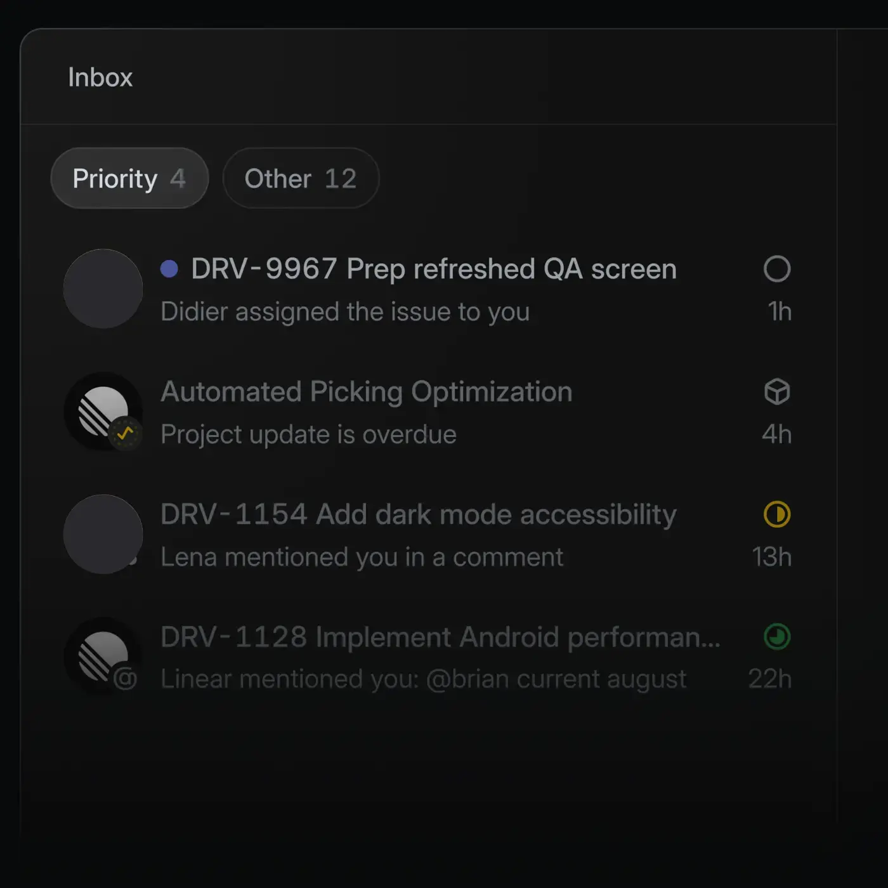

- Product / view: Linear, Inbox list (Priority / Other tabs), notification rows
- Source page: https://linear.app/docs/inbox
- Image URL: https://webassets.linear.app/images/ornj730p/production/b442b340278740de70919c868dce1afca4335fe7-3600x2080.png (cropped to the list panel)
- Redacted: dark discs cover the two portrait avatars.
- Captured: 2026-11-17
- Basis: vendor-published product screenshot, used for design commentary (fair use), attribution to Linear (Linear Orbit, Inc.)
- Shows: a narrow Inbox column with two pill tabs, "Priority 4" and "Other 12", and four notification rows fading toward the bottom; the right half is an empty detail pane.
- Observations:
  - Panel structure: image shows a two-pane layout - list column on the left, detail pane on the right (empty in this crop, a vertical divider is visible). Header row "Inbox" sits above the tabs.
  - Scroll regions: not visible in a still. Inferred: list scrolls on its own, header and tabs stay put (the bottom fade is decorative marketing masking, not a scroll cue).
  - Input placement: no composer in this view. Triage actions are per-row (see keyboard).
  - Live updates / layout stability: not visible in a still. The only live-state marker shown is a blue dot before the title of the newest row (unread). Docs describe a "Show unread first" and ordering setting, so new items are ordered by rule rather than inserted under the cursor (see the Inbox display options at https://linear.app/docs/inbox).
  - Density and typography: ~3 lines of text per row pair (title on line 1, reason on line 2), 2-line rows ~ 64 px at 1x in the original; large avatar (40 px) with a small badge glyph in its corner for the event type (assigned arrow, quote for comment, @ for mention, chart for project update). Title in primary text color, reason in muted grey; relative time right-aligned ("1h", "4h", "13h", "22h").
  - Status signaling: right column carries the issue's status icon (empty circle = todo, half-yellow = in progress, green = done-ish/in review) and a cube for a project. Event type is carried by the avatar corner badge, not by text color. Few colors, one accent (indigo unread dot).
  - Keyboard flow: Linear documents j/k navigation, Enter to open and Cmd+K command menu; inbox-specific actions (mark done, snooze with a reminder picker) are described at https://linear.app/docs/inbox (shortcuts per docs; not verified in a still).
  - Empty / loading states: not shown.
  - Steal this: (1) two pill tabs with counts that split "needs me" from "everything else" (Priority 4 / Other 12) - maps to Decisions vs Activity; (2) one unread dot instead of bold or reordering; (3) a 2-line row: identifier+title on top, reason line below, relative age on the right.
  - Avoid: the avatar-with-corner-badge needs a person per event; our events are mostly system/worker notes, so use the badge idea for event kind only.

### linear-triage.webp

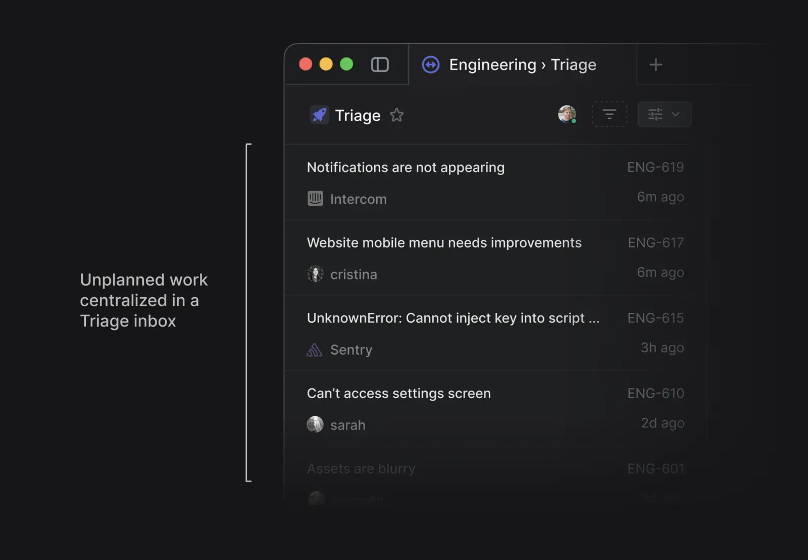

- Product / view: Linear, Triage inbox (team "Engineering > Triage")
- Source page: https://linear.app/docs/triage
- Image URL: https://webassets.linear.app/images/ornj730p/production/30183e73c9ef009bb8cb14adbe97d9f34a5b9a69-2352x1632.png
- Captured: 2026-11-17
- Basis: vendor-published product screenshot, used for design commentary (fair use), attribution to Linear (Linear Orbit, Inc.)
- Shows: a desktop window frame with a tab "Engineering > Triage", a view header (title, star, assignee avatar, filter button, display-options button) and five two-line rows from different intake sources, captioned "Unplanned work centralized in a Triage inbox".
- Observations:
  - Panel structure: window chrome with a tab strip (tab per view, "+" to add), a header bar with the view title on the left and filter/display controls on the right, then a flat list. Sidebar and detail pane are cropped out.
  - Scroll regions: not visible in a still. The last row fades out at the bottom, suggesting a scrolling list under a fixed header (inferred).
  - Input placement: no composer shown. Header toolbar (filter, display) is pinned above the list.
  - Live updates / layout stability: not visible in a still. Rows are ordered newest-first by age ("6m ago" on top, "2d ago" below), so a new arrival would land at the top (inferred from ordering).
  - Density and typography: ~46 px per row at 1x in the original (title line + source line), about 14-15 px title, 13 px muted meta line. Identifier (ENG-619) right-aligned in muted grey, age under it.
  - Status signaling: the second line names the source with an icon (Intercom, a person, Sentry); no per-row status chip because every row is by definition "untriaged". State is implied by which queue you are in.
  - Keyboard flow: triage actions (accept, duplicate, decline, snooze) have documented shortcuts; see https://linear.app/docs/triage (not verified in a still).
  - Empty / loading states: not shown.
  - Steal this: (1) a queue defined by "what has no answer yet", so presence in the list is the status; (2) source icon + name on the meta line so items from different producers are scannable; (3) title left, identifier and age stacked right.
  - Avoid: row meta is low-contrast grey on near-black; the age line is hard to read at a glance.

### linear-issue-agent-panel.webp

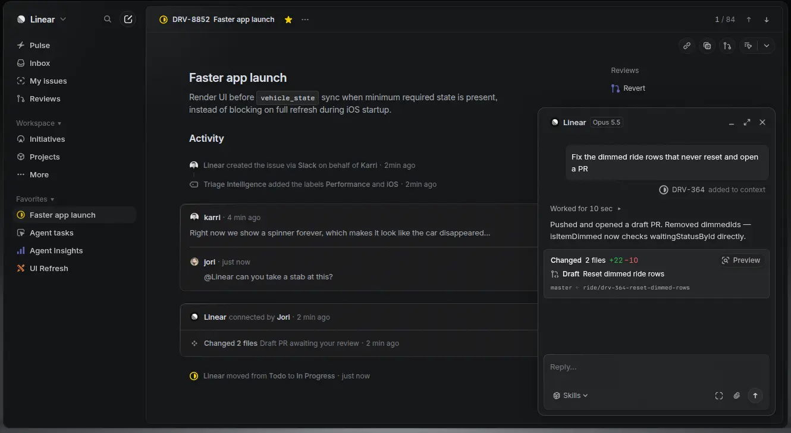

- Product / view: Linear, issue detail with a docked agent chat and reply composer
- Source page: https://linear.app/ (hero product mock)
- Image URL: live capture of https://linear.app/ at 1500x1100, cropped to the app mock (public marketing page, no login)
- Captured: 2026-11-17
- Basis: live capture of a public vendor marketing page showing staged product UI, used for design commentary (fair use), attribution to Linear
- Shows: left sidebar (Pulse, Inbox, My issues, Reviews, Workspace, Favorites), issue "DRV-8852 Faster app launch" with an activity timeline, a properties column on the right, and a floating agent panel with a transcript, a "Changed 2 files" result card, and a "Reply..." composer.
- Observations:
  - Panel structure: three regions - persistent left nav, center issue canvas with a header row (identifier, title, star, "1 / 84" position with up/down arrows), and a right properties column; the agent chat floats over the lower right as a docked card with its own header (name, model badge, minimize/expand/close).
  - Scroll regions: not visible in a still. Inferred: the center canvas scrolls under a pinned header; the agent card's transcript is its own region above a pinned composer.
  - Input placement: composer sits at the bottom of the agent card with a "Reply..." placeholder, a Skills dropdown, expand, attach and send controls on one row. It stays visible while the transcript above is a separate area.
  - Live updates / layout stability: activity lines carry "just now", "2min ago", "4 min ago" stamps, so the feed is live; how new lines are inserted is not visible in a still. "Worked for 10 sec >" is a collapsed disclosure that hides intermediate agent steps behind one line.
  - Density and typography: small sans (about 13-14 px) for activity lines, muted grey for system events, white for human comments in bordered cards; section titles ("Activity") larger. System events are a single dim line with a tiny icon; human comments get a card with a divider.
  - Status signaling: a single yellow half-circle for "In Progress" in the header and in the log line; the result card uses green "+22" and red "-10" diff counts and a "Draft" PR label. Very restrained palette.
  - Keyboard flow: the "1 / 84" counter with arrows implies list navigation from the parent list (inferred); Linear's shortcuts are listed at https://linear.app/docs/keyboard-shortcuts-and-command-menu (not verified here).
  - Empty / loading states: not shown.
  - Steal this: (1) a docked chat card with its own pinned composer, so the reply box is always reachable; (2) system events as one dim line and human replies as bordered cards, so decisions stand out of the noise; (3) a collapsed "Worked for 10 sec" row that hides worker detail but keeps it one click away.
  - Avoid: the agent card overlaps the properties column (it covers part of the page), which would hide content on a small viewport.

### github-projects-board.webp

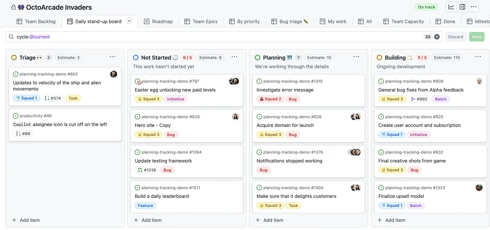

- Product / view: GitHub Projects, Board layout with filter bar and view tabs
- Source page: https://docs.github.com/en/issues/planning-and-tracking-with-projects/customizing-views-in-your-project/changing-the-layout-of-a-view
- Image URL: https://docs.github.com/assets/cb-287583/images/help/projects-v2/example-board.png
- Captured: 2026-11-17
- Basis: GitHub Docs image, licensed CC BY 4.0 (the github/docs README: "Creative Commons Attribution 4.0 - for documentation and content in the assets, content, and data folders"). Attribution: GitHub, Inc., docs.github.com.
- Shows: project "OctoArcade Invaders", a row of saved-view tabs, a filter box (`cycle:@current`, count 25), and four columns (Triage, Not Started, Planning, Building) of cards.
- Observations:
  - Panel structure: project title bar with a status pill ("On track") and icon buttons; a tab strip of saved views (Team Backlog, Daily stand-up board, Roadmap, ... "All", "Done", overflowing at the right); a filter bar; then horizontal columns.
  - Scroll regions: not visible in a still. Inferred: board scrolls horizontally across columns and each column scrolls vertically; the title bar, view tabs and filter bar stay fixed. Each column header shows a count and a numeric rollup (Estimate: 3, "6 / 5" in red when over a limit).
  - Input placement: the filter bar is a persistent text input at the top; "+ Add item" sits at the foot of every column, so creating an item is local to the column.
  - Live updates / layout stability: not visible in a still.
  - Density and typography: cards ~ 85-105 px with repo + number on top, title, then label chips; column headers carry a status dot (yellow / blue / green), name, item count and a description line ("This work hasn't started yet").
  - Status signaling: status is the column itself (colored dot + name + count). Chips color-code type/size (Task, Bug, Feature, Squad 3). Limits show in red ("6 / 5", "5 / 3"). Many saturated colors on a white card, so it is colorful rather than quiet.
  - Keyboard flow: GitHub documents `?` for shortcuts and `/` to focus the filter; project shortcuts at https://docs.github.com/en/get-started/accessibility/keyboard-shortcuts (not verified in a still).
  - Empty / loading states: not shown.
  - Steal this: (1) a count and an over-limit red count in the column header (e.g. "waiting 3"); (2) a persistent filter bar with query syntax and a Save / Discard pair that appears only when the query changed; (3) "+ Add item" at the foot of each column.
  - Avoid: tab strip overflows to the right with "..." clipping; many chip colors compete with the status color.

### github-projects-table.webp

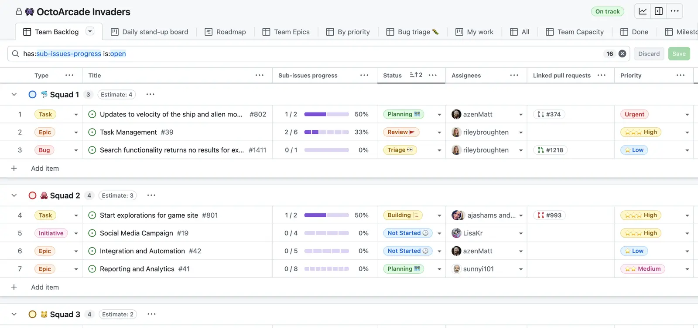

- Product / view: GitHub Projects, Table layout grouped by field
- Source page: https://docs.github.com/en/issues/planning-and-tracking-with-projects/customizing-views-in-your-project/changing-the-layout-of-a-view
- Image URL: https://docs.github.com/assets/cb-257253/images/help/projects-v2/example-table.png
- Captured: 2026-11-17
- Basis: GitHub Docs image, licensed CC BY 4.0 (the github/docs README: "Creative Commons Attribution 4.0 - for documentation and content in the assets, content, and data folders"). Attribution: GitHub, Inc., docs.github.com.
- Shows: the "Team Backlog" view, filter `has:sub-issues-progress is:open` (count 16), rows grouped into "Squad 1/2/3" with a sub-issue progress bar, status pill, assignee, linked PR and priority columns.
- Observations:
  - Panel structure: same title bar, view tabs and filter bar as the board; below, a table with a sticky column header row and collapsible group headers carrying counts and an estimate rollup.
  - Scroll regions: not visible in a still. Inferred: the table scrolls vertically under the sticky header and horizontally for extra columns (Priority is clipped at the right edge, which suggests horizontal overflow).
  - Input placement: filter bar on top (always visible); "+ Add item" row at the end of every group.
  - Live updates / layout stability: not visible in a still. The row index column (1..7) is numbered across groups, so inserting a row shifts numbers but not column widths.
  - Density and typography: ~28 px rows, 13 px text, one line per row: type chip, title with issue number, progress bar with fraction and percent, status chip, avatar + login, linked PR, priority chip.
  - Status signaling: Status and Priority are colored pill chips with emoji; progress is a segmented bar with a percent. The state of every row is readable in one horizontal scan.
  - Keyboard flow: arrow keys move across cells and Enter opens an item (per GitHub's project docs; not verified in a still).
  - Empty / loading states: not shown.
  - Steal this: (1) a one-line row with status chip, progress bar, PR link and assignee as aligned columns - good for the Tickets list; (2) collapsible groups with a count in the header; (3) sticky column header for a dense list.
  - Avoid: very wide tables clip the last column; for our 1-column-per-panel shell, keep fewer columns and let the row wrap instead.

### jira-board.webp

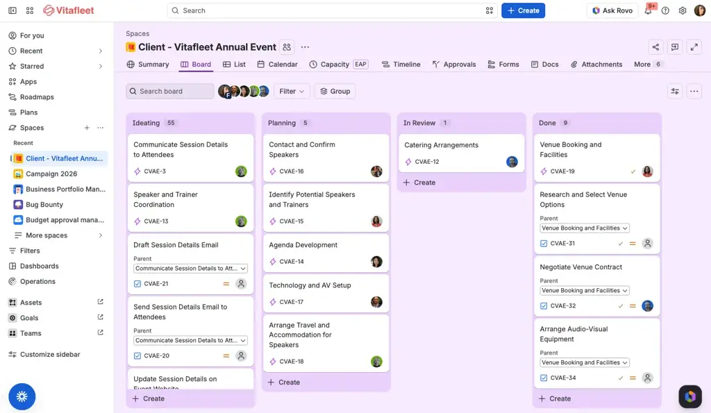

- Product / view: Jira, Board (Kanban) with project sidebar and global nav
- Source page: https://www.atlassian.com/software/jira/guides/boards/overview
- Image URL: https://dam-cdn.atl.orangelogic.com/CDNLink/AT12OH0A.webp
- Captured: 2026-11-17
- Basis: vendor-published product screenshot from an Atlassian guide, used for design commentary (fair use), attribution to Atlassian. Vendor-staged demo data ("Vitafleet").
- Shows: global top bar (search, blue "Create" button, "Ask Rovo", notification badge 9+), left sidebar (For you, Recent, Starred, Spaces...), a project tab bar (Summary, Board, List, Calendar, ...), a search + avatar + Filter + Group toolbar, and four columns (Ideating 55, Planning 5, In Review 1, Done 9).
- Observations:
  - Panel structure: three nested bars above content - global top bar, project header with tabs, board toolbar - then columns. Left sidebar is a separate full-height region.
  - Scroll regions: not visible in a still. Evidence: the last card in the first column is cut off at the bottom edge and the column ends with a visible "+ Create" row below, which suggests per-column vertical scrolling with a pinned footer (inferred). The board region has a horizontal gap at the right, so columns would scroll horizontally if more were added.
  - Input placement: "+ Create" is in the global top bar (always reachable) and at the foot of every column; "Search board" sits in the board toolbar.
  - Live updates / layout stability: not visible in a still. A notification bell with a "9+" count is the only live indicator.
  - Density and typography: cards ~ 70-100 px, issue key and avatar at the bottom, title 13 px; column header with pill count. Column colors are a pastel tint across the whole board (lavender here).
  - Status signaling: status is the column; issue-type icons are tiny; priority shows as a small orange "=" icon on some cards; an avatar shows the assignee. Contrast on the light pastel is low.
  - Keyboard flow: Jira keyboard shortcuts documented at https://support.atlassian.com/jira-software-cloud/docs/use-keyboard-shortcuts/ (not verified in a still).
  - Empty / loading states: not shown.
  - Steal this: (1) "+ Create" in the global bar and also at each column foot; (2) column header with a small count pill; (3) toolbar with search + Filter + Group directly above the board.
  - Avoid: stacking three header bars costs ~130 px of vertical space before any content; and the page-wide tint reduces contrast on status.

### Cross-cutting patterns: issue boards and work queues

- Every reference separates "needs a human" from "everything else" by queue or tab (Linear Priority / Other, Triage inbox, GitHub Triage column), with a count on the tab or column header.
- The count lives in the header of the queue (pill or muted number), not inside the rows, so it stays visible while the rows scroll.
- A fixed header stack (title, view tabs, filter/search/toolbar) sits above a region that scrolls on its own; headers never scroll with the data.
- Create/add entry is local and always reachable: "+ Add item" or "+ Create" at the foot of every group or column, plus a global Create button in the top bar (Jira) or a compose icon next to the workspace name (Linear sidebar).
- Rows are two-line: identifier and title on top, a muted reason/source line below, relative age or status on the right. Unread is a single dot, not a color flood.
- System events are quiet, human items are prominent: dim one-line activity text for machine events, bordered cards for human replies (Linear issue view).
- Status is shown by position first (column or queue), then by one small icon or pill; Linear uses a very restrained palette with one accent, GitHub and Jira use many chip colors and are noisier.
- Filtering is a persistent text bar with a query syntax and visible counts (GitHub `cycle:@current  25`), with Save/Discard shown only when the query changed.
- A chat/reply composer is a pinned card with its own transcript above it (Linear agent card), not an element at the end of a page.
- Collapsed disclosures ("Worked for 10 sec >") hide worker detail without removing it.
- None of these stills show how new rows arrive; the "no jump" behavior has to be taken from vendor docs or a live demo, and was not verified here.

## Live feeds with a pinned composer

All four images are vendor-staged data (fictional names, stock avatars); nothing was captured behind a login. "Image shows" = read off the pixels; "inferred" = from product knowledge or vendor docs, not visible in the still.

### slack-channel-thread.webp

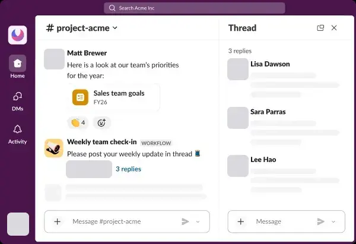

- Product / view: Slack, channel (#project-acme) with a thread side panel open
- Source page: https://slack.com/features/channels
- Image URL: https://d1kmis9bmaw00z.cloudfront.net/pending/470b3847-75fe-41d3-bdc2-585c463def77/img-channels-ui.jpg
- Redacted: light bars cover the author and thread-reply portraits, the reply avatars and the account photo.
- Captured: 2026-11-17
- Basis: vendor-published product screenshot, used for design commentary (fair use), attribution to Slack Technologies (Salesforce). Native size 600x411; not upscaled.
- Shows: workspace rail (Home, DMs, Activity), a channel header, three message items (a card attachment, a workflow post with "3 replies" link, loading skeleton rows), a right-hand Thread panel with its own header and its own composer, and a composer at the bottom of each pane.
- Observations:
  - Panel structure: 3 columns at this crop: narrow workspace rail (Home / DMs / Activity icons + avatar at bottom), channel message pane (center), thread pane (right, ~38% width, close button + pop-out icon in its header). The channel sidebar list is not shown in this crop (the Slack help-center wireframes show it as a second column with `#` rows and a count badge).
  - Scroll regions: image shows two independently framed message areas (channel, thread) each with its own header above and composer below, so the headers and composers are the fixed chrome and the message list between them is the scroll region (inferred from the framing, the still cannot show scrolling).
  - Input placement: one composer pinned at the bottom of EACH pane ("Message #project-acme" with `+` on the left, send arrow plus a dropdown chevron on the right; the thread pane has "Message" with the same controls). Composer is always visible; it is a rounded single-line box that grows (inferred).
  - Live updates / layout stability: not visible in a still. Slack's help-center article (https://slack.com/help/articles/360059928654) labels the left-rail badges (a count badge on the active workspace, on Activity, on Saved) and a numeric badge on a channel row; those are unread markers that live outside the message pane.
  - Density and typography: message items ~65 px tall at 600 px image width, bold sender name (15 px-equivalent) over a regular body line, 1-2 lines per message; avatars are 32 px rounded squares. Medium density, lots of white space between items.
  - Status signaling: almost no color: purple only for the rail and the selected state; blue link text for "3 replies" (the thread entry point); reaction pill with a count (clapping hands 4) and an add-reaction ghost pill; a small gray "WORKFLOW" tag next to the automated sender; a green presence dot on the user avatar bottom-left.
  - Keyboard flow: not shown in the image, and no shortcuts page was read, so nothing is claimed.
  - Empty / loading states: the gray skeleton bars (two rows at the bottom of the channel pane and three in the thread) are Slack's own loading pattern as drawn by the vendor.
  - Steal this: (1) a side panel that opens beside the feed for a single item's detail and has its own composer, so replying to one item never navigates away from the feed; (2) put the unread/needs-attention count badge on the nav item, not in the feed; (3) a small gray type tag ("WORKFLOW") to mark machine-authored rows.
  - Avoid: the composer is a single-line-looking box with a send arrow; there is no per-message action row visible, so the primary action for a decision (approve / deny) would need to be built from the card attachment pattern, not from emoji reactions.

### zulip-stream-topics.webp

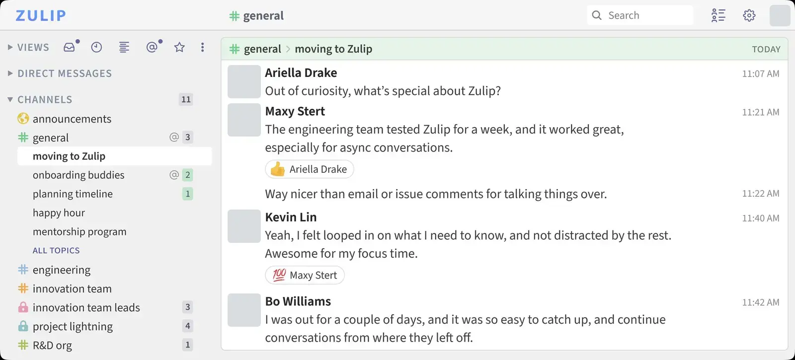

- Product / view: Zulip, channel list with topics and unread counts beside a topic message feed
- Source page: https://zulip.com/
- Image URL: https://static.zulipchat.com/static/images/landing-page/hello/generated/screen-1-2x.jpg
- Redacted: light bars cover the four message-author portraits and the account photo.
- Captured: 2026-11-17
- Basis: vendor-published product screenshot, used for design commentary (fair use), attribution to Zulip / Kandra Labs. (Zulip's server code is Apache-2.0; the landing-page image license was not checked.) Fictional staged users with stock portraits.
- Shows: top bar (logo, current channel name, search, icons), left sidebar (VIEWS icon row, DIRECT MESSAGES, CHANNELS with per-channel unread badges and an expanded `general` channel listing its topics), right pane with a green sticky header "general > moving to Zulip   TODAY" and four messages with avatars, times, and emoji reactions.
- Observations:
  - Panel structure: 2 panels under a full-width top bar. Left sidebar is a tree: Views (icon row: inbox with dot, recent, all, mentions with dot, starred, overflow) / Direct messages / Channels (each channel can expand to its topics, with an "ALL TOPICS" link). Right pane is the message feed for the selected topic. (The real app also has a right sidebar of users, not in this crop.)
  - Scroll regions: the crop is cut at the bottom of both panes. Inferred from the product: sidebar and feed scroll independently, the feed's topic header sticks to the top (image shows the header as a distinct tinted bar above the first message), and the compose box sits under the feed. The composer is NOT visible in this image.
  - Input placement: not visible (cropped). Search is a field in the top bar, always visible.
  - Live updates / layout stability: image shows per-topic unread count badges (green-tinted number chips, a gray `@` icon plus count for mentions) and a dot on the inbox and mentions icons in the Views row. How new messages arrive is not visible in a still.
  - Density and typography: sidebar rows ~24 px at this scale, topics indented under the channel with a lighter weight; selected topic has a white pill background. Message rows: bold name, regular body, time right-aligned in gray in the same line as the name; consecutive messages from the same sender collapse the avatar/name (the "Way nicer than email..." line is a continuation with its own time on the right).
  - Status signaling: color-coded channel glyphs (green `#` for the current channel, orange, blue, red lock for private) and green unread chips; sticky topic bar is tinted with the channel color, so "where am I" is read from color alone; the mention badge is differentiated from the plain unread badge by the `@` glyph.
  - Keyboard flow: not shown in the image; not read.
  - Empty / loading states: none visible.
  - Steal this: (1) topic-per-conversation tree in the sidebar: each unit of work (a ticket) is a child row with its own unread badge, and the badge shows mentions (needs-you) distinct from plain unread; (2) a sticky tinted context header ("channel > topic") over the feed, so you always know which unit you are looking at; (3) a Views icon row (inbox, recent, mentions, starred) with a dot on the ones that have something new.
  - Avoid: the tree gets tall when many topics are expanded ("ALL TOPICS" link needed); our board needs a flat prioritized queue for decisions, not a tree.

### thunderbird-unified-inbox.webp

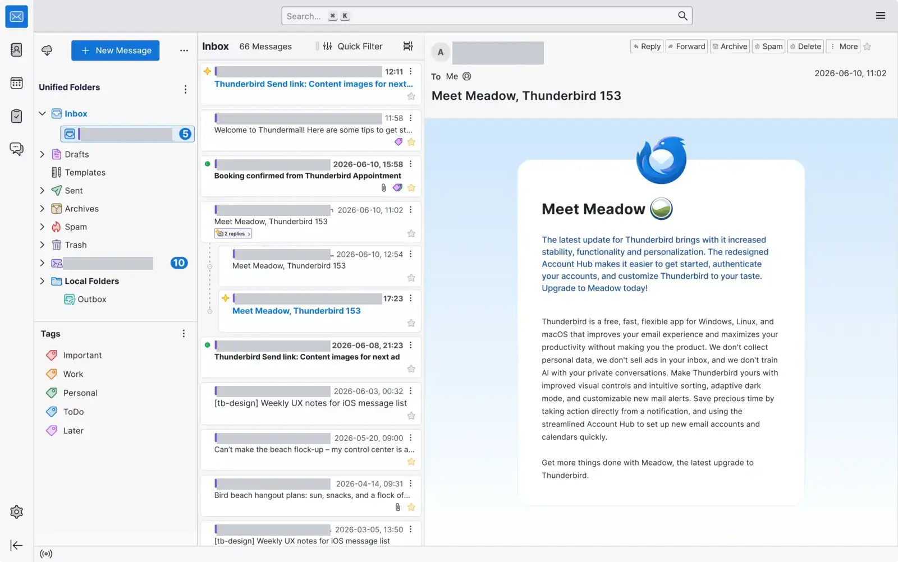

- Product / view: Mozilla Thunderbird 153 ("Meadow"), Inbox with message list and reading pane
- Source page: https://www.thunderbird.net/en-US/
- Image URL: https://www.thunderbird.net/media/img/thunderbird/new/screens/153-mail-screen.avif
- Redacted: grey bars cover every sender name and email address and the two account names, since the repository keeps email addresses out of its docs.
- Captured: 2026-11-17
- Basis: vendor-published product screenshot, used for design commentary (fair use), attribution to Thunderbird / MZLA Technologies (Thunderbird is MPL-2.0 open-source software; the website image terms were not checked). Staged mail on vendor demo domains, with no private people.
- Shows: far-left app rail (mail, address book, calendar, tasks, chat; settings and collapse at the bottom), folder pane (New Message button, Unified Folders with unread counts on accounts, Tags), message list "Inbox 66 Messages" with Quick Filter, and a reading pane with Reply / Forward / Archive / Spam / Delete / More.
- Observations:
  - Panel structure: 4 columns: 52 px rail, folder pane (~255 px), message list (~355 px), reading pane (rest) plus a global search bar centered in the top strip (placeholder "Search...  ⌘ K"). Classic list-plus-detail, ~1400x876 image.
  - Scroll regions: image shows a list cut off mid-row at the bottom (the last row is truncated) and the folder pane with a Tags section below a divider, so list and folder pane scroll independently (inferred from the truncated row). Reading pane header (sender, To, date, subject) and the action button row are a pinned header above the message body (inferred from layout).
  - Input placement: search is in the top strip, always visible, with a shortcut hint in the field; "New Message" is a blue primary button at the top of the folder pane, always visible. Compose happens in a separate window/tab (inferred; no composer on screen). Inline Quick Filter sits in the list header.
  - Live updates / layout stability: not visible in a still. Image shows unread count chips on accounts (5 and 10), bold sender+subject on unread rows with blue subject text on the selected/unread, a purple left-edge bar on each row, and a "2 replies" thread chip with nested replies connected by a vertical line.
  - Density and typography: message rows are two-line cards ~70 px tall, sender and date on line 1 (bold when unread), subject on line 2, rows separated by a thin rounded border; a row action `⋮` appears at the top right of each row and a star at the bottom right. Folder pane rows ~29 px. Reading pane body ~15 px with generous margins.
  - Status signaling: green dot (new/unread), star (yellow when starred), tag chip (purple), paperclip, a reply arrow glyph next to the sender; blue text for unread/selected; unread counts in blue pills. About 6 distinct row-level signals, all small icons on line 2 or right edge.
  - Keyboard flow: shortcut hint `⌘ K` in the search field is visible; no other shortcuts read, nothing else claimed.
  - Empty / loading states: none visible.
  - Steal this: (1) list rows as two-line cards with a fixed right column for date + row actions, so a row never changes height when its state changes; (2) a pinned action row (Reply / Forward / Archive / Spam / Delete) in the detail header, every action one click away on the selected item; (3) a "N replies" thread chip that expands nested rows inline with a connector line, a pattern for nested worker rows under a ticket.
  - Avoid: left-edge colored bars on every row (all rows have the same purple) add noise without meaning; five columns of chrome leave only ~50% width for content at 1400 px.

### claude-code-agent-view.webp

- Product / view: Claude Code "agent view" (`claude agents`): terminal dashboard of background sessions grouped by state, with a dispatch input at the bottom
- Source page: https://code.claude.com/docs/en/agent-view
- Image URL: https://mintcdn.com/claude-code/H7YQo-xfDxC94ETh/images/agent-view-light.png (light-theme image from the docs; the page also carries a dark variant)
- Captured: 2026-11-17
- Basis: vendor-published product screenshot from official docs, used for design commentary (fair use), attribution to Anthropic. Staged sessions ("api client retries", "dark mode toggle"), no personal data.
- Shows: a summary line "1 awaiting input · 1 working · 2 completed", three groups (Needs input, Working, Completed) with one row each (two under Completed), a selected row marker, a horizontal rule, a one-line dispatch input "describe a task for a new session", and a hint row.
- Observations:
  - Panel structure: single full-width column in the still: counts line / grouped list / rule / input / hint line. The docs describe a separate peek panel opened with `Space` (shows the full question, linked PRs, "waiting 3m", and a reply input) and attach with `→` to the full transcript. So it is list + on-demand detail, not a permanent split.
  - Scroll regions: the docs say agent view takes over the full terminal; the list is the scrolling region and the counts line (top) and the input plus hints (bottom) are fixed chrome (inferred from the docs and the layout; the still shows no overflow, though the docs example ends with "… 6 more" under Completed, a collapse instead of scroll).
  - Input placement: dispatch input pinned at the bottom of the screen, between two rules, always the focused control; typing text that is not a filter and pressing Enter dispatches a new session. A reply to an existing session is done from the peek panel input, not from this one.
  - Live updates / layout stability: not visible in a still. Docs (https://code.claude.com/docs/en/agent-view) say: sessions that need you sort to the top; the terminal tab title shows "N awaiting input"; a notification fires when a background session starts needing input, finishes, or fails; a finished session's age freezes. Docs example also shows "Pinned" and "Ready for review" groups above Needs input, and `Ctrl+T` pins a row so it stays put.
  - Density and typography: monospace, one line per session, 4 columns: state icon, name (colored by the user's `/color`), latest status or the question text truncated with "…", age right-aligned ("12m", "3m", "40m", "1h"). Group headers are bold with a blank line above. Very high information density: ~38 px rows at this scale in a 1872 px wide image.
  - Status signaling: icon shape and color carry the state: yellow animated `✻/✽` for needs input, animated for working, green dot for completed, per the docs table (also Idle dimmed, Failed red, Stopped grey; 6 states). The needs-input group is first and its row text is the actual question ("Should the API client retry on 429, or surface the error to the calle..."). PR status appears as `#N` or `!N` at the row's right edge.
  - Keyboard flow: documented at https://code.claude.com/docs/en/agent-view: `Up/Down` move, `Space` peek, `Enter` attach or submit, `Right` attach, `Tab` on an empty input applies a suggested reply, press a choice's number to answer a multiple-choice question, `Ctrl+T` pin, `Ctrl+S` switch grouping by state or directory, `Ctrl+F` filter, `Alt+Up/Down` jump between group headers, `Ctrl+X` stop (twice to delete), `?` shows shortcuts. Hints row in the image shows "enter to open · space to reply · ctrl+x to remove · ? for shortcuts".
  - Empty / loading states: not shown.
  - Steal this: (1) group by "what needs you", with Needs input first and the row text being the question itself, so the queue can be triaged without opening anything; (2) the pinned bottom input for creating a new item, with reply done inline for an existing one via a peek panel opened by Space, so neither entry point moves with the list; (3) a summary count line at the top ("1 awaiting input · 1 working · 2 completed") that mirrors into the document title.
  - Avoid: reply is not the same input as create (two entry points: bottom dispatch and the peek panel), and the docs note that replying to a permission prompt does not answer it (the message waits in a queue, you must attach); our decision cards should answer the real prompt directly.

### Cross-cutting patterns: live feeds with a pinned composer

- Every reference keeps three things as fixed chrome and scrolls only the middle: header or context line, the list or feed, and the input. None of them places inputs at the end of the content.
- Composer or entry point is bound to the pane it acts on: Slack has one per pane (channel and thread), Claude Code agent view has one dispatch input at the bottom plus a reply input in the peek panel.
- Detail opens beside or over the list on demand (Slack thread panel, Thunderbird reading pane, agent view peek panel) instead of navigating away or pushing the list down.
- Unread or needs-attention state is shown as small count badges on the navigation items (Slack rail, Thunderbird accounts, Zulip topics), with a different glyph for "mentions you" (Zulip `@`); the feed itself is not reflowed to announce it.
- A summary count lives at the top and in the window or tab title ("1 awaiting input", per the agent view docs), so state is readable without looking at the list.
- Rows are fixed-height one- or two-line items with the time or age right-aligned and row actions in the same place on every row, so a state change swaps an icon instead of resizing the row.
- Groups are by what the human must do (Needs input / Working / Completed), not by creation order; the first group is the one that needs a person and its row text is the actual ask.
- State is encoded in a small icon shape plus color, 4 to 6 states maximum, with the row text unchanged; color is never the only carrier (shape or glyph also varies).
- Context is shown by a sticky header (Zulip's tinted "channel > topic" bar, Thunderbird's sender/subject/actions header), so the user always knows which item they are acting on.
- Nested rows are inline and light: a "N replies" chip or an indented topic line with a connector, not a separate page.

### Could not get: live feeds with a pinned composer

- Discord: no usable official image. discord.com marketing images are illustrations, gradient tiles, and a rendered monitor mock too small to read; real in-app screenshots live on support.discord.com pages that were not found with staged data, and Discord's own client needs a login.
- Zulip live capture: https://chat.zulip.org opened without login (public view, Recent conversations), but anonymous viewers get no composer and the feed shows real community members' names, so the vendor's staged landing image was used instead. That image crops off the composer, so Zulip's composer placement is inferred, not shown.
- Fastmail (https://www.fastmail.com/features/): the only official image there is a marketing collage (search popover over a photo), no list plus reading pane. Superhuman (https://superhuman.com/): only cropped feature cards, no full list plus reading pane. Thunderbird was used for the mail archetype instead.
- Cursor and OpenAI Codex product pages: static images were cropped feature shots or video posters, not a multi-pane view with a pinned prompt; not used.
- Slack: only a 600 px wide image is published on the feature page; the full-size help-center images are annotated wireframes (gray bars) with no real text, which were not used.

## Ops and CI dashboards

### grafana-alerting-dashboard.webp

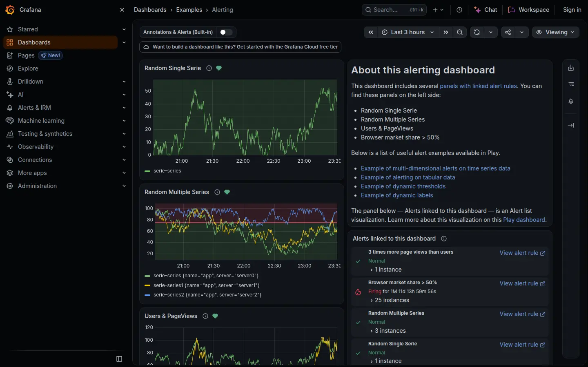

- Product / view: Grafana, "Alerting" example dashboard (time-series panels plus an Alert list panel), dark theme
- Source page: https://play.grafana.org/d/000000074/alerting
- Image URL: live capture of https://play.grafana.org/d/000000074/alerting (1440x900 viewport)
- Captured: 2026-11-17
- Basis: live capture of a public demo instance (Grafana Labs play.grafana.org, no login, synthetic/random data), attribution to Grafana Labs
- Shows: left column of three stacked time-series panels with health hearts; right column holds an explainer text panel above an "Alerts linked to this dashboard" alert-list panel with Normal and Firing rows.
- Observations:
  - Panel structure: app shell with a collapsible left nav (about 300 px), a breadcrumb/search top bar, a dashboard toolbar (time range, refresh, share, Viewing) and a slim right-hand icon rail (export, outline, alerts, collapse). Content is a two-column grid; panels are rounded dark cards with a title row. The alert list is a panel, not a page.
  - Scroll regions: the nav and the dashboard canvas are separate regions inside a fixed viewport (nav is pinned; the canvas scrolls with the page-level toolbar above it). Inferred from the layout; a still cannot prove it. The alert-list panel is cut off at the bottom of the viewport, so panel content scrolls with the canvas, not inside the card, at this size.
  - Input placement: no composer. Search is a persistent top-bar field with a `ctrl+k` hint; the toolbar controls (time range, refresh interval) are always at the top of the canvas.
  - Live updates / layout stability: refresh is a user-set interval (dropdown next to the refresh button), and each panel redraws in place inside a fixed-size card, so nothing reflows. Not visible in a still beyond that.
  - Density and typography: panel titles about 14 px semibold, row text 12-13 px; alert rows about 70 px tall with a three-line stack (rule name bold, state + duration, instance count disclosure). Moderate density, lots of card padding.
  - Status signaling: icon plus colored word per row - amber hourglass "Pending", red flame "Firing", green check "Normal" - with duration ("for 1M 11d 13h 59m 56s"). Panel titles carry a green heart for health. Three states, icon + text, not color alone.
  - Keyboard flow: global search on `ctrl+k`. Docs: https://grafana.com/docs/grafana/latest/dashboards/use-dashboards/#keyboard-shortcuts
  - Empty / loading states: not visible in this still.
  - Steal this: (1) state = icon + colored word + elapsed time on one line per row, with "N instances" as an expandable child row (maps to a ticket with nested worker rows); (2) a "View alert rule" link at the right edge of each row, same slot on every row; (3) list as a panel that sits beside graphs, so the queue has a fixed home.
  - Avoid: the explainer text panel and promo banner eat the top of the viewport; long unbounded durations ("1M 11d ...") make rows noisy.

### grafana-alert-rules.webp

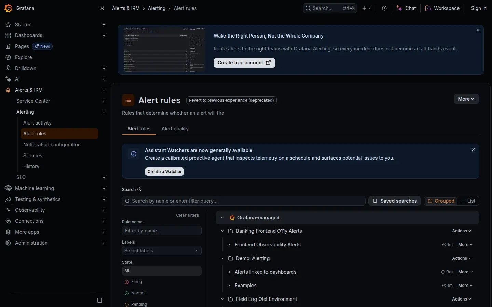

- Product / view: Grafana, Alerting > Alert rules page (search, state filters, grouped list)
- Source page: https://play.grafana.org/alerting/list
- Image URL: live capture of https://play.grafana.org/alerting/list (1440x900 viewport)
- Captured: 2026-11-17
- Basis: live capture of a public demo instance (Grafana Labs play.grafana.org, no login), attribution to Grafana Labs
- Shows: Alert rules page with a promo banner, an info banner, a full-width search field, a filter column (rule name, labels, state: Firing / Normal / Pending) and a folder-grouped rule list with per-group Actions menus.
- Observations:
  - Panel structure: left nav (expanded to the Alerting subtree), a page header with tabs (Alert rules / Alert quality), then a two-column body: a filter sidebar (about 235 px) and the grouped list. A Grouped/List toggle and a Saved searches button sit on the search row.
  - Scroll regions: the page body scrolls as one document here (banners push the list below the fold) - a counterexample. Nav is pinned. Inferred from the banners occupying 500 px of vertical space before the list.
  - Input placement: search is a wide field directly above the list, with an inline filter query syntax placeholder ("Search by name or enter filter query..."); it is not pinned, so it scrolls away.
  - Live updates / layout stability: not visible in a still. Two dismissible banners above the list (each with an x) suggest content that shifts the list down when it appears.
  - Density and typography: group rows about 40 px, rule rows about 40 px, 13-14 px text, right-aligned secondary info (evaluation interval with clock icon, "More" menu). Tidy and scannable.
  - Status signaling: state filter lists Firing (red ring), Normal (green check), Pending (amber ring) as small icon + label rows; color + shape both used.
  - Keyboard flow: not shown; Grafana global `ctrl+k`.
  - Empty / loading states: not visible.
  - Steal this: (1) filter facets as a left column with a "Clear filters" link and visible state counts-style rows; (2) "Grouped | List" segmented toggle plus "Saved searches" beside the search box; (3) every group row has its own "Actions" menu at a fixed right edge.
  - Avoid: promo/info banners stacked above the primary list push the work out of the first viewport; do not let dismissible banners sit in the scroll flow.

### datadog-oncall-pages.webp

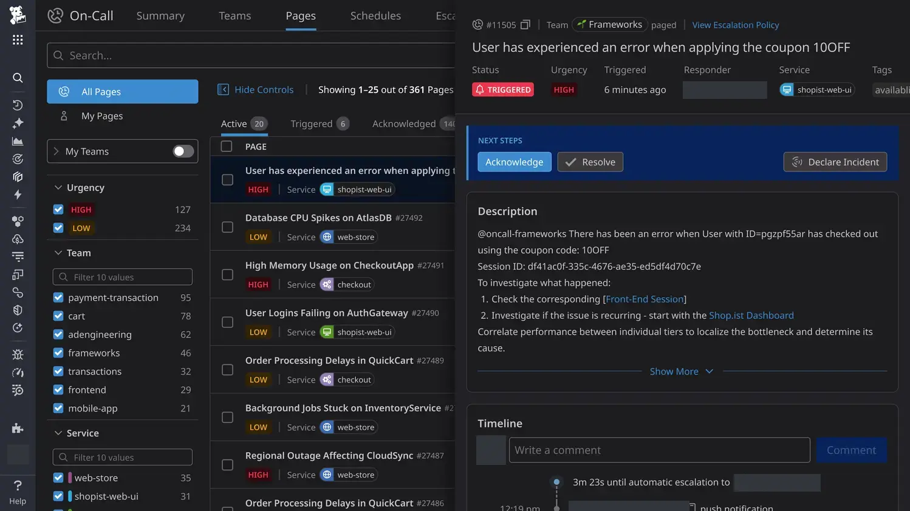

- Product / view: Datadog On-Call, Pages list with a page-detail pane (Acknowledge / Resolve / Declare Incident, comment composer)
- Source page: https://www.datadoghq.com/product/incident-management/
- Image URL: https://corp.dd-static.net/img/products/hero-v2/product_hero_incidentresponse_250806_dark.png?format=png&auto=format&fit=max&w=1498
- Redacted: dark bars cover the staged responder names and portraits in the header, the timeline and the side navigation.
- Captured: 2026-11-17
- Basis: vendor-published product screenshot, used for design commentary (fair use), attribution to Datadog, Inc. Data is vendor-staged ("Shop.ist" demo, staged names).
- Shows: three-region layout: dark left rail, faceted filter column (Urgency, Team, Service with counts), a tabbed queue list (Active 20 / Triggered 6 / Acknowledged 140), and a right detail pane for one page with next-step buttons, description and a timeline with a comment input.
- Observations:
  - Panel structure: icon rail (about 60 px) | filters (about 250 px) | queue list | detail pane (about 50% width, opens beside the list, list stays visible and the selected row is highlighted). Top has "On-Call" title with sub-tabs (Summary, Teams, Pages, Schedules, Escalation).
  - Scroll regions: list and detail are two scrollable regions side by side (inferred; the list is clipped at the pane edge and the detail is clipped at the bottom). Filter column and rail are pinned.
  - Input placement: Search field at top of the filter column; comment composer ("Write a comment" + Comment button) at the top of the Timeline section in the detail pane, so the reply box is reachable without scrolling to the end of a long timeline. Action buttons (Acknowledge, Resolve, Declare Incident) sit in a highlighted "NEXT STEPS" band directly under the title.
  - Live updates / layout stability: tab chips with live counts (Active 20, Triggered 6) are the "something changed" signal; the "Showing 1-25 out of 361 Pages" label gives scale. Whether new rows insert above the viewport is not visible in a still.
  - Density and typography: list rows about 78 px, 14 px title, small chips beneath (urgency chip, "Service" + service pill, id #27492); detail pane uses large 20 px title and 14 px body. Facet rows about 30 px with right-aligned counts.
  - Status signaling: urgency as a filled chip (HIGH red, LOW amber), "TRIGGERED" as a red badge with a bell icon, tabs as count pills (Triggered in red-tinted pill). Few colors, labelled text on every chip.
  - Keyboard flow: not shown. Datadog docs: https://docs.datadoghq.com/service_management/on-call/
  - Empty / loading states: not visible.
  - Steal this: (1) a "NEXT STEPS" action band right under the title of the detail pane (primary Acknowledge, secondary Resolve, escalation to the far right) maps to decision-card reply buttons; (2) tab strip with live count pills (Active / Triggered / Acknowledged) as the queue's status filter; (3) comment box placed at the top of the timeline rather than at the end.
  - Avoid: the detail pane takes half the width and clips the list columns; a three-column layout at 1500 px leaves the queue cramped.

### datadog-dashboard.webp

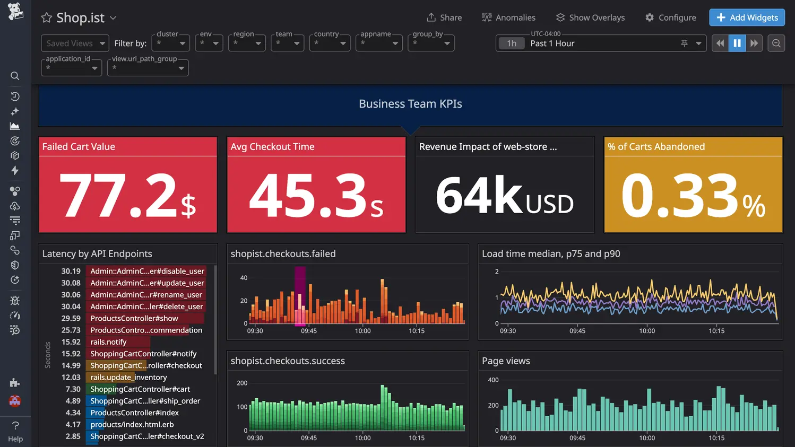

- Product / view: Datadog, Dashboard "Shop.ist" with KPI tiles and timeseries/top-list widgets, dark theme
- Source page: https://www.datadoghq.com/product/platform/dashboards/
- Image URL: https://corp.dd-static.net/img/products/hero-v2/product_hero_platform_dashboards_250815_dark.png?format=png&auto=format&fit=max&w=1498
- Captured: 2026-11-17
- Basis: vendor-published product screenshot, used for design commentary (fair use), attribution to Datadog, Inc. Data is vendor-staged.
- Shows: dashboard header with template-variable filters (cluster, env, region, team, ...), time controls with a pause/play button, a banner group "Business Team KPIs", four large KPI tiles (red, red, neutral, amber) and a grid of top-list and bar/line widgets.
- Observations:
  - Panel structure: slim icon rail on the left, a header band (title, Share / Anomalies / Show Overlays / Configure, blue Add Widgets button) and a filter row, then a widget grid with group banners.
  - Scroll regions: the header and filter band look pinned above the canvas (the grid starts under a darker band edge); the widget canvas scrolls under it. Inferred from the shadow under the band.
  - Input placement: filters ("Filter by:" plus dropdowns) always at the top; the time range (Past 1 Hour) has a pause button and rewind/forward steppers, which is the live-update control.
  - Live updates / layout stability: explicit pause/play toggle (blue, pressed) in the time control lets the viewer freeze a live dashboard while inspecting; a highlighted pink band over the failed-checkout chart marks a selected time range across widgets. A still cannot show updates but the control exists.
  - Density and typography: KPI tiles use about 100 px numerals with a small title strip (about 16 px) - strong hierarchy; chart widgets are small with 11-12 px axis labels. Medium-high density.
  - Status signaling: whole-tile fills (red = bad, amber = warning, neutral = informational) plus numbers; contrast is very high, but meaning is carried by color alone on the KPI tiles.
  - Keyboard flow: not shown. Docs: https://docs.datadoghq.com/dashboards/ (shortcuts section).
  - Empty / loading states: not visible.
  - Steal this: (1) a Pause/Play toggle in the time control to freeze live updates; (2) a large-numeral KPI strip with a one-word title for glanceable counts (running / waiting / failed); (3) filters in a pinned header band, widgets scroll below.
  - Avoid: color-only tile status; the filter band is two rows tall and costs vertical space.

### buildkite-pipelines.webp

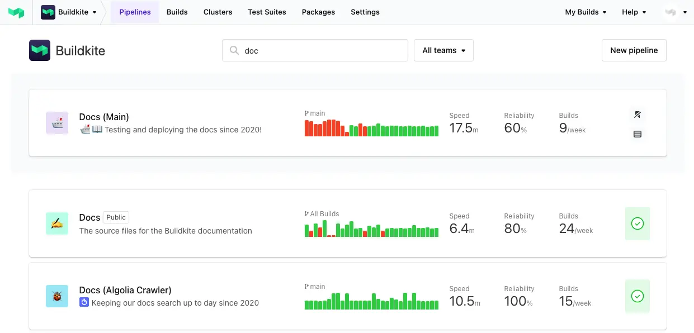

- Product / view: Buildkite, Pipelines list with per-pipeline history bars and stats
- Source page: https://buildkite.com/docs/pipelines/dashboard-walkthrough
- Image URL: https://buildkite.com/docs/assets/pipelines-hIn6hlvf.png
- Captured: 2026-11-17
- Basis: vendor-published product screenshot, used for design commentary (fair use), attribution to Buildkite. Docs-site image; no license stated on the page.
- Shows: top app nav (Pipelines, Builds, Clusters, Test Suites, Packages, Settings), an org header with search, team filter and "New pipeline", then pipeline cards each with description, a bar history of recent builds (green/red), Speed, Reliability, Builds/week and a status button at the right.
- Observations:
  - Panel structure: single-column list of cards under a top nav; each card is one row-level summary with fixed columns (name+description, branch + history bars, three stats, state icon).
  - Scroll regions: whole page scrolls (not a shell). Top nav is the only fixed element, inferred from convention; a still cannot show it.
  - Input placement: search field is centered at the top of the list, always above the first card; "New pipeline" is a bordered button top-right, "All teams" dropdown next to the search.
  - Live updates / layout stability: not visible in a still. The bar history gives a stable-width sparkline per row, so a new build changes one bar in place instead of adding a row.
  - Density and typography: cards about 120 px tall - low density; name 16 px, description 14 px gray, stats 28 px numerals with 12 px labels. Scannable but costly in vertical space.
  - Status signaling: red/green bars per build (binary, no text) plus a green check button at right for the latest state; stats as numerals. Two states in the history; color-only on the bars.
  - Keyboard flow: not shown.
  - Empty / loading states: not visible.
  - Steal this: (1) one bar per recent run as a built-in history strip on a ticket row (stable width, updates in place); (2) a fixed right-hand column for latest status; (3) a "Pipelines" nav plus search+filter pair above the list.
  - Avoid: tall cards; only a few rows fit per viewport; no sticky header.

### github-actions-workflow-graph.webp

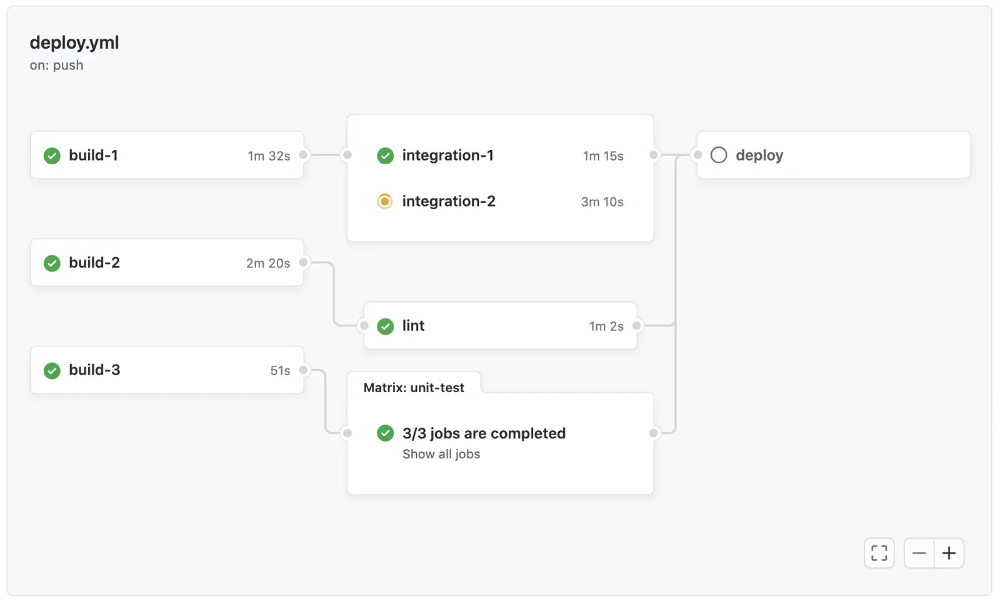

- Product / view: GitHub Actions, workflow run graph (jobs as nodes with dependencies, status icon and duration per node)
- Source page: https://docs.github.com/en/actions/how-tos/monitor-workflows/use-the-visualization-graph
- Image URL: https://docs.github.com/assets/cb-63715/images/help/actions/workflow-graph.png
- Captured: 2026-11-17
- Basis: GitHub Docs image, licensed CC BY 4.0 (the github/docs README: "Creative Commons Attribution 4.0 - for documentation and content in the assets, content, and data folders"). Attribution: GitHub, Inc., docs.github.com.
- Shows: deploy.yml graph with build-1/2/3 feeding integration, lint and a matrix group ("3/3 jobs are completed, Show all jobs"), converging on a pending "deploy" node; zoom/fit controls at the bottom right.
- Observations:
  - Panel structure: one graph canvas inside a card with a header (workflow file name, trigger). Nodes are left-to-right columns by dependency depth.
  - Scroll regions: pan/zoom canvas with explicit `-`, `+` and fit-to-screen buttons pinned bottom-right (visible in image).
  - Input placement: no composer; controls are on-canvas. In the real UI the job list is a left sidebar with a log pane on the right (not in this image).
  - Live updates / layout stability: nodes keep a fixed size and position; state and duration change inside the node (the amber ring on integration-2 is "running", the empty ring on deploy is "queued/waiting"). Matrix jobs collapse into one node with a summary and a "Show all jobs" link, which stops fan-out from moving the layout.
  - Density and typography: nodes about 85 px tall; job name 16 px semibold, duration right-aligned in gray 13 px. Light theme.
  - Status signaling: green filled check = success, amber ring with dot = in progress, hollow gray circle = not started; each paired with the name and duration. Three to four states, distinct by shape, not only color.
  - Keyboard flow: not shown in the image; docs for the graph at the source page.
  - Empty / loading states: the hollow "deploy" node is a not-yet-started state.
  - Steal this: (1) status glyph at the left of each row with shape differing per state (check / ring / hollow); (2) collapsing a group of similar jobs into one summary node with "N/N completed" and an expander (maps to nested worker rows); (3) right-aligned duration in muted type.
  - Avoid: graph layout is only useful for dependency views; for a flat queue it wastes space.

### Cross-cutting patterns: ops and CI dashboards

- Status is shown as a glyph or chip with a text label (Firing/Pending/Normal, TRIGGERED, HIGH/LOW, passed/failed), not color alone; shapes differ per state (check, ring, hollow circle, flame, hourglass).
- The queue always has a fixed home: a list panel beside graphs (Grafana), a middle pane with a detail pane next to it (Datadog On-Call), or a card list under a nav (Buildkite).
- Live counts in tab chips (Active 20 / Triggered 6 / Acknowledged 140) are how queues signal change without moving rows.
- Detail opens beside the list rather than replacing it, and the selected row stays highlighted (Datadog On-Call).
- Next-step actions are grouped in one band directly under the item title (Acknowledge / Resolve / Declare Incident), with the comment box at the top of the timeline.
- Filters and search live in fixed places: a facet column with counts and "Clear filters" (Grafana, Datadog), or a header band with template variables and a pause button (Datadog dashboards).
- Time-based live views carry an explicit freeze control (Datadog pause/play) and a user-set refresh interval (Grafana); updates redraw in fixed-size cards.
- Groups collapse into summary rows with a count and an expander ("2 instances", "3/3 jobs are completed, Show all jobs").
- History is shown as a fixed-width strip (Buildkite bars) so a new run changes one mark in place.
- Counterexamples: banners and promo panels stacked above the list (Grafana alert rules) and tall cards (Buildkite) push the work off the first viewport; these pages scroll as one document.
